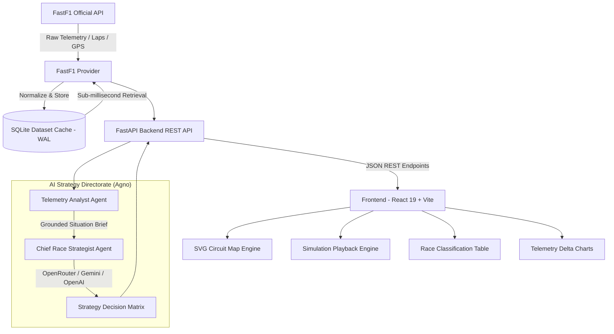

# 🏎️ PitwallIQ — Formula 1 Tactical Telemetry & AI Strategy Directorate

[](https://fastapi.tiangolo.com)
[](https://react.dev)
[](https://vitejs.dev)
[](https://docs.fastf1.dev)
[](https://www.sqlite.org)
[](https://agno.com)
[](https://tailwindcss.com)

**PitwallIQ** is a mission-control Formula 1 tactical race engineering dashboard. It unites authentic GPS car telemetry, smoothed vector track geometry, real-time race simulation playback, persistent local SQLite caching, and an autonomous **2-Tier Agno Multi-Agent AI Strategy Directorate** to deliver real-time pitstop strategy, undercut/overcut calculations, and tyre degradation predictions.

---

## 📸 Key Features

### 1. 🗺️ High-Fidelity Telemetry Circuit Map
- **Authentic Track Geometry**: 40+ official circuits (Bahrain, Jeddah, Albert Park, Suzuka, Shanghai, Monaco, Spa, Silverstone, etc.) mapped via authentic GPS telemetry coordinates.
- **Catmull-Rom Cubic Bezier Smoothing**: Transforms raw telemetry coordinates into fluid, continuous SVG racing tracks without sharp polygon kinks.
- **Dynamic Corner Markers**: Automatically detects turns (e.g., `T1` through `T16`) using official corner telemetry and curvature vectors.
- **Motorsport Start/Finish Gate**: True-to-life perpendicular start/finish line with red & white racing stripes.
- **Real-Time Car Blips**: Visualizes top 10 cars with official team liveries, driver pills (`VER`, `LEC`, `HAM`, `NOR`), and focus glow on the selected target driver.

### 2. ⚡ Zero-Latency Persistent Dataset Caching
- **SQLite WAL Mode Engine**: Normalized F1 telemetry payloads (dashboards, track layouts, driver lap records) are cached persistently in SQLite with WAL mode (`PRAGMA journal_mode=WAL`), delivering **< 0.5 ms** retrieval times.
- **CLI Dataset Prefetcher**: Background CLI tool to warm up seasons and rounds ahead of time (`python -m backend.scripts.prefetch_dataset`), completely eliminating cold FastF1 download hangs during frontend browsing.
- **High-Precision Circuit Database**: Built-in 40+ circuit catalog with instant fallbacks if external network requests are unavailable.

### 3. ⏱️ Motorsport Simulation & Playback Engine
- **Realistic Telemetry Pace**: Configured to match real F1 lap times (~75–80s per lap at `1x` real-time), preventing frantic, unnatural car movements.
- **Speed Multipliers**: Granular speed controls (`1x`, `2x`, `4x`, `8x`).
- **Interactive Scenarios**:
  - **Safety Car**: Deploys the Safety Car in front of the race leader with automatic pit window triggers.
  - **Box Call**: Triggers an instant pitstop simulation for fresh tyre compounds (`SOFT`, `MEDIUM`, `HARD`).
  - **Interactive Lap Scrubber**: Jump to any lap of the Grand Prix.

### 4. 🧠 Agno 2-Tier AI Pitwall Directorate
- **Tier 1 — Telemetry Analyst Agent**: Analyzes sector deltas, tyre wear trajectories, stint progression, and gap evolution against rival drivers.
- **Tier 2 — Chief Race Strategist Agent**: Evaluates pitstop windows, undercut feasibility, track position delta, and contingency plans (Plan A / Plan B / Safety Car).
- **Quick Tactical Pills**: 1-click execution for standard race engineer questions:
  - *Assess Undercut on P2*
  - *Tyre Cliff Warning*
  - *Pit Window & Clean Air*
  - *Safety Car Plan B Contingency*

### 5. 👻 Data Ghost — Head-to-Head Telemetry Comparator
- **Synchronized Flying Lap Telemetry**: Directly compare any two drivers' fastest laps interpolated across 240+ normalized distance points.
- **Multi-Track SVG Telemetry Visualization**:
  - **Track 1: Speed Trace (km/h)**: Compare top speeds, corner apex minimum speeds, and deceleration rates.
  - **Track 2: Delta Time ($\Delta t$)**: Dynamic timeline showing where time was won or lost throughout the lap.
  - **Track 3: Throttle & Brake Dynamics**: Compare pedal input timing—who brakes later and who gets on the gas earlier on corner exit.
- **Interactive Telemetry HUD**: Hovering across tracks displays real-time speed deltas, throttle %, brake status, and gear selection at that exact meter of the track.

### 6. 📊 Real-Time Classification & Telemetry Delta
- **Live Classification Table**: Live standings, driver intervals, tyre compound badges, and tyre stint ages.
- **Pace Comparison Chart**: Interactive lap pace telemetry comparing your selected driver against key rivals (e.g., `VER vs LEC`) with designated pit window zones.

---

## 🏗️ System Architecture



---

## 📁 Repository Structure

```text
pitwalliq/
├── backend/
│   ├── app/
│   │   ├── main.py                     # FastAPI application entrypoint
│   │   ├── core/
│   │   │   ├── config.py               # Pydantic BaseSettings & env loader
│   │   │   └── dataset_cache.py        # SQLite persistent dataset cache engine
│   │   ├── api/v1/
│   │   │   ├── router.py               # Central API router
│   │   │   ├── seasons.py              # Seasons & championship calendar endpoints
│   │   │   ├── events.py               # Grand Prix weekend events
│   │   │   ├── sessions.py             # Dashboard, driver laps, track map, cache stats
│   │   │   └── strategy.py             # Agno AI strategy evaluation endpoint
│   │   ├── agents/
│   │   │   ├── analyst.py              # Agno Telemetry Analyst agent
│   │   │   ├── strategist.py           # Agno Chief Race Strategist agent
│   │   │   └── workflow.py             # Two-Tier Race Strategy Workflow orchestration
│   │   ├── providers/
│   │   │   ├── base.py                 # Abstract F1 provider interface
│   │   │   └── fastf1_provider.py      # FastF1 telemetry adapter & L2 cache layer
│   │   ├── schemas/
│   │   │   ├── common.py               # Standardized response envelopes
│   │   │   ├── f1.py                   # Pydantic models for F1 data
│   │   │   └── strategy.py             # Strategy request & recommendation schemas
│   │   └── data/
│   │       └── circuits.json           # GPS coordinates for 40+ official F1 circuits
│   ├── scripts/
│   │   ├── prefetch_dataset.py         # CLI tool to prefetch and warm up SQLite cache
│   │   └── process_circuits.py         # Circuit geometry normalization helper
│   ├── cache/
│   │   ├── pitwall_dataset.db          # Persistent SQLite database (git-ignored)
│   │   └── fastf1/                     # FastF1 raw disk cache (git-ignored)
│   ├── requirements.txt                # Python backend dependencies
│   └── .env.example                    # Backend environment configuration template
│
├── frontend/
│   ├── src/
│   │   ├── main.jsx                    # React entrypoint
│   │   ├── App.jsx                     # Mission-control dashboard container
│   │   ├── index.css                   # Tailwind CSS styling & animations
│   │   ├── api/
│   │   │   └── client.js               # API client with fallbacks & auto-retry
│   │   ├── components/
│   │   │   ├── CircuitMap.jsx          # SVG Track & live car blip renderer
│   │   │   ├── SimulationControls.jsx  # Playback & speed controls
│   │   │   ├── ClassificationTable.jsx # Live driver standings
│   │   │   ├── TelemetryChart.jsx      # Recharts lap delta comparison
│   │   │   ├── StrategyDirectorate.jsx # AI pitwall strategist chat & decision matrix
│   │   │   └── Toast.jsx               # Notifications banner
│   │   └── data/
│   │       └── circuits.json           # Client-side circuit geometry fallback
│   ├── package.json                    # Frontend dependencies & scripts
│   └── vite.config.js                  # Vite bundler configuration
│
├── .gitignore                          # Clean repository ignore configuration
└── README.md                           # Project documentation
```

---

## 🚀 Getting Started

### Prerequisites
- **Python**: `3.11` or `3.12`
- **Node.js**: `18.x` or `20.x` (with `npm`)
- **AI Model Key**: An [OpenRouter](https://openrouter.ai/) API key, [Google Gemini](https://aistudio.google.com/) API key, or [OpenAI](https://platform.openai.com/) API key.
- **F1 Account** (optional, for authenticated FastF1 live timing data)

---

### 1. Backend Setup

1. **Navigate to the backend directory and set up a virtual environment:**
   ```bash
   cd backend
   python -m venv .venv
   
   # Windows (PowerShell)
   .\.venv\Scripts\Activate.ps1
   
   # Linux / macOS
   source .venv/bin/activate
   ```

2. **Install backend dependencies:**
   ```bash
   pip install -r requirements.txt
   ```

3. **Configure Environment Variables:**
   Copy `.env.example` to `.env`:
   ```bash
   cp .env.example .env
   ```
   Edit `.env` with your preferred model provider:
   ```env
   # OpenRouter Configuration
   OPENROUTER_API_KEY=your_openrouter_api_key_here
   OPENROUTER_MODEL=anthropic/claude-3.5-sonnet  # or deepseek/deepseek-chat
   OPENROUTER_DECISION_MODEL=anthropic/claude-3.5-sonnet

   # Google Gemini (Alternative)
   GEMINI_API_KEY=your_gemini_api_key_here
   GEMINI_MODEL=gemini-2.0-flash

   # FastF1 Settings (Optional)
   FASTF1_CACHE_ENABLED=true
   F1_USERNAME="your_f1_account_email"
   F1_PASSWORD="your_f1_account_password"
   ```

4. **(Recommended) Pre-fetch F1 Datasets into SQLite:**
   Warm up the cache for Season 2026 Round 1 & Round 2 (or any season) so frontend requests respond instantly:
   ```bash
   # From the workspace root:
   python -m backend.scripts.prefetch_dataset --season 2026 --rounds 1 2
   
   # Inspect SQLite cache stats:
   python -m backend.scripts.prefetch_dataset --stats
   ```

5. **Start the FastAPI backend server:**
   ```bash
   uvicorn backend.app.main:app --reload --port 8000
   ```
   - API Root: `http://127.0.0.1:8000`
   - Interactive Swagger Docs: `http://127.0.0.1:8000/docs`

---

### 2. Frontend Setup

1. **Navigate to the frontend directory:**
   ```bash
   cd frontend
   ```

2. **Install dependencies:**
   ```bash
   npm install
   ```

3. **Start the Vite development server:**
   ```bash
   npm run dev
   ```
   Open your browser at `http://localhost:5173/`.

---

## ⚡ CLI Dataset Prefetcher Guide

FastF1 downloads 50–150 MB of raw Pandas DataFrames per race session. The built-in CLI prefetcher processes and caches only the lightweight normalized JSON records in SQLite, ensuring instant frontend navigation:

```bash
# Prefetch Season 2026 Round 1 (Australian GP) and Round 2 (Chinese GP):
python -m backend.scripts.prefetch_dataset --season 2026 --rounds 1 2

# Prefetch all rounds for Season 2026:
python -m backend.scripts.prefetch_dataset --season 2026 --all-rounds

# Prefetch specific historical rounds (e.g., 2024 Rounds 1 to 3):
python -m backend.scripts.prefetch_dataset --season 2024 --rounds 1 2 3

# View database size and entry breakdown:
python -m backend.scripts.prefetch_dataset --stats
```

---

## 📡 API Reference

All backend endpoints are prefixed under `/api/v1` and return standardized responses:

| Method | Endpoint | Query / Body Parameters | Description |
| :--- | :--- | :--- | :--- |
| `GET` | `/api/v1/seasons` | — | List of supported F1 championship seasons |
| `GET` | `/api/v1/events` | `season=2026` | List of Grand Prix events for a season |
| `GET` | `/api/v1/sessions/dashboard` | `season=2026&round_number=1&session_name=Race` | Full classification, tyre stints, and race status |
| `GET` | `/api/v1/sessions/track-map` | `season=2026&round_number=1&session_name=Race` | Circuit coordinates and corner definitions |
| `GET` | `/api/v1/sessions/driver-laps` | `season=2026&round_number=1&session_name=Race&driver_number=1` | Lap-by-lap timing, sector deltas, and tyre compounds |
| `GET` | `/api/v1/sessions/ghost-comparison` | `season=2026&round_number=1&session_name=Race&driver1=1&driver2=16` | Synchronized head-to-head lap telemetry (speed trace, Δt, throttle, brake) |
| `GET` | `/api/v1/sessions/cache-stats` | — | SQLite persistent cache health, file size, and record counts |
| `POST`| `/api/v1/strategy/evaluate` | `StrategyRequest` (JSON) | Two-tier Agno AI Strategy evaluation and decision matrix |

### Example Strategy Request Payload
```json
{
  "season": 2026,
  "round_number": 1,
  "session_name": "Race",
  "driver_number": "1",
  "rival_driver_numbers": ["16", "44"],
  "current_lap": 18,
  "query": "Assess undercut viability against Leclerc. Should we box this lap?"
}
```

---

## 🛠️ Git Clean Commit Guide

To commit the repository cleanly without untracked artifacts or local skill files:

```bash
# 1. Untrack local build artifacts and configuration files (if tracked previously)
git rm -r --cached .agents graphify-out DEV_GUIDE.md PROJECT.md skills-lock.json

# 2. Stage only project files
git add backend/ frontend/ .gitignore README.md

# 3. Check status to ensure no .db or cache files are staged
git status

# 4. Commit cleanly
git commit -m "feat: complete PitwallIQ with SQLite persistent caching and Agno AI Strategy Directorate"
```

---

## 📄 License
MIT License. Developed for Formula 1 motorsport analysis, telemetry visualization, and tactical AI research.
